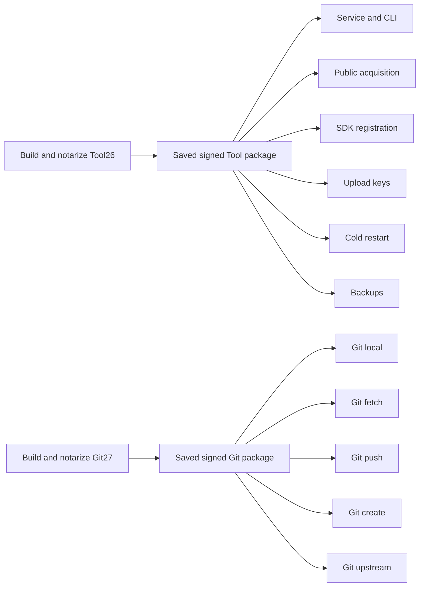

# macOS candidate retries

Use the verification branch `verify/desktop-macos-candidate`. This workflow does
not modify `main` or publish a release. The main workflow builds the candidates;
`desktop-macos-candidate-tests.yml` contains the reusable test groups.

After a failure, open the run and choose **Re-run failed jobs**. To retry one job,
use that job's **Re-run job** control. Successful jobs and their saved packages
are reused; **Re-run all jobs** deliberately rebuilds and is not the recovery
path. The command-line equivalent for failed jobs is `gh run rerun RUN_ID --failed`.

Each test job starts on a fresh Mac runner. It downloads the exact saved package,
verifies its origin and checksums, then creates/signs the transport images and
installs with the existing Installer and readback checks. It only compiles the
small package producer. It does not compile the app, remover, CLI or runtime,
and does not repeat app/package notarization. Disk-image signing or installation
failures therefore rerun inside that test job, after the saved-package boundary.
Bounded disk-image signing and detach logs are retained for diagnosis.

Service and SDK prerequisites run again where needed on a fresh runner. Another
job's registered service, SDK catalogue or credentials cannot supply that state.
The key, restart and backup groups therefore run SDK registration before their
selected cases. Independent jobs do not turn skipped prerequisites into passes.

Packages are kept for 14 days and named by full source commit, scope, run and
producer attempt. A retry selects the one successful producer checkpoint across
run attempts, not the newest artifact or the current test attempt. Missing,
expired, damaged, mismatched or ambiguous inputs fail before installation.

Changing application code requires a new signed candidate. A failed build before
its checkpoint also still needs a build retry. This split removes the repeated
long build from later installation and test failures; it does not claim that an
unfinished build or an older binary can verify changed source.
