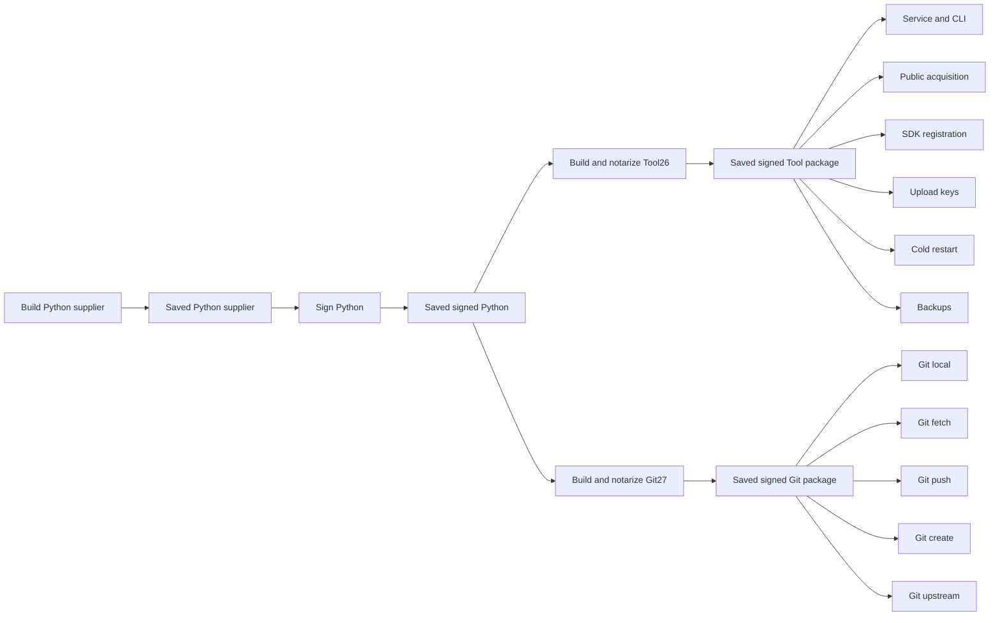

# macOS candidate retries

Use the verification branch `verify/desktop-macos-candidate`. This workflow does
not modify `main` or publish a release. The main workflow builds the candidates;
`desktop-macos-candidate-tests.yml` contains the reusable test groups.



New candidate pushes build both packages and run Git local plus service/CLI first.
After those pass, dispatch the remaining nine groups independently with the same
saved source/run. All eleven successful groups remain required; unexecuted groups
are pending, never passes. This avoids spending five more Tool jobs on a shared
service failure.

If the pinned Python supplier is unavailable, dispatch `desktop-macos-installed.yml`
with operation `candidate-python-source` and target `aarch64-apple-darwin` on
the same candidate branch. It calls `desktop-macos-candidate-python-source.yml`
and runs only the ARM source supplier. Both workflow files are source-bound;
the other build/install/signing jobs stay closed and no signing secrets are passed.
Its original preparation, native
probes, source checks and retirement must succeed before it retains the tar and
receipt for90 days. It accepts the actually observed SDK27.0 while retaining
minimum deployment26.0; future SDK versions remain refused. The historical
supplier branches are unchanged. This step does not start either candidate build
or qualify a signed runtime. A separately verified signed derivation and new
source-bound candidates are still required before installed test groups resume.

```sh
gh workflow run desktop-macos-installed.yml --ref verify/desktop-macos-candidate \
  -f operation=candidate-python-source -f target=aarch64-apple-darwin
```

Once the source supplier is verified and its actual pins are committed, run only
`candidate-python-sign` to create the signed Python capsule in the existing
`macos-developer-id` environment. It retains the original signature/native probes
and clean-source checks, saves successful output for90 days, and starts no app
builds. Verify the actual signed capsule and compose its runtime binding before
starting both fresh candidates. Neither recovery stage qualifies installed groups.

```sh
gh workflow run desktop-macos-installed.yml --ref verify/desktop-macos-candidate \
  -f operation=candidate-python-sign -f target=aarch64-apple-darwin
```

After a failure, open the run and choose **Re-run failed jobs**. To retry one job,
use that job's **Re-run job** control. Successful jobs and their saved packages
are reused; **Re-run all jobs** deliberately rebuilds and is not the recovery
path. The command-line equivalent for failed jobs is `gh run rerun RUN_ID --failed`.

Each test job starts on a fresh Mac runner. It downloads the exact saved package,
verifies its origin and checksums, then creates/signs the transport images and
installs with the existing Installer and readback checks. It only compiles the
small package producer. Cold producer tests/builds have a shared15-minute cap;
all signing, Installer, readback and detach command caps stay unchanged.
It does not compile the app, remover, CLI or runtime,
and does not repeat app/package notarization. Disk-image signing or installation
failures therefore rerun inside that test job, after the saved-package boundary.
Bounded disk-image signing and detach logs are retained for diagnosis.

Service and SDK prerequisites run again where needed on a fresh runner. Another
job's registered service, SDK catalogue or credentials cannot supply that state.
The key, restart and backup groups therefore run SDK registration before their
selected cases. Independent jobs do not turn skipped prerequisites into passes.

Packages are kept for 14 days and named by full source commit, scope, run and
producer attempt. A retry selects the one successful producer checkpoint across
run attempts, not the newest artifact or the current test attempt. Missing,
expired, damaged, mismatched or ambiguous inputs fail before installation.

Before either candidate build starts expensive preparation, fast checks cover
Installer transport, dialog compilation, checkpoint gates, and the real runner's
Git/Library flags, and actual Objective-C service phases with inert service and
gate edges in ordinary and observed builds. The flag check directly compiles the application's small guard
with the pinned Rust compiler; it needs no application build or credentials.
The local preflight additionally exercises actual Git source custody beneath a
disposable hidden ancestor when supplied a compiled Git test binary.

The compiled observer also runs its startup DATA contracts before more helper
builds or notarization. Local preflight accepts `--observer-test-bin` for this
check; the binary must have explicit recorded runtime manifest/protocol inputs.
This does not install or qualify a service.

Changing application code requires a new signed candidate. A failed build before
its checkpoint also still needs a build retry. This split removes the repeated
long build from later installation and test failures; it does not claim that an
unfinished build or an older binary can verify changed source.

For a test/packaging script correction, select **Run workflow**, operation
**candidate-tests**, the saved package's full `prepared_source` and `prepared_run`,
and one `test_group`. This dispatch does not run either build. GitHub's complete
ancestor comparison must contain only the finite harness/documentation allowlist;
native/app/runtime code, compiler inputs, signing profiles and pins cannot change.
When the current source is the saved source, dispatch accepts that exact match
without an unnecessary comparison file. Changed test scripts still require the
complete ancestor comparison and its existing allowlist checks.
The package reader and small producer build still use the immutable original
checkout. The current harness and original application source are recorded
separately. A missing signing credential fails before package download.

When pushing only a harness correction for this route, `[skip ci]` in the commit
message prevents the push-triggered builds; explicitly dispatch the selected
test afterward. This does not qualify the changed application as newly built.
GitHub copies successful job rows into rerun attempts; checkpoint selection also
requires an actual artifact for the producer attempt so copied rows do not look
like duplicate builds.
